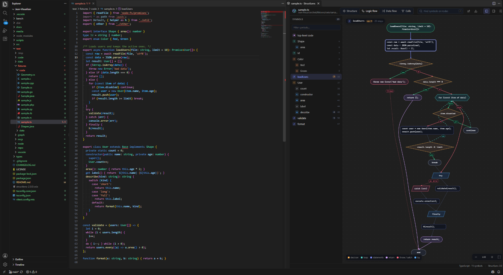
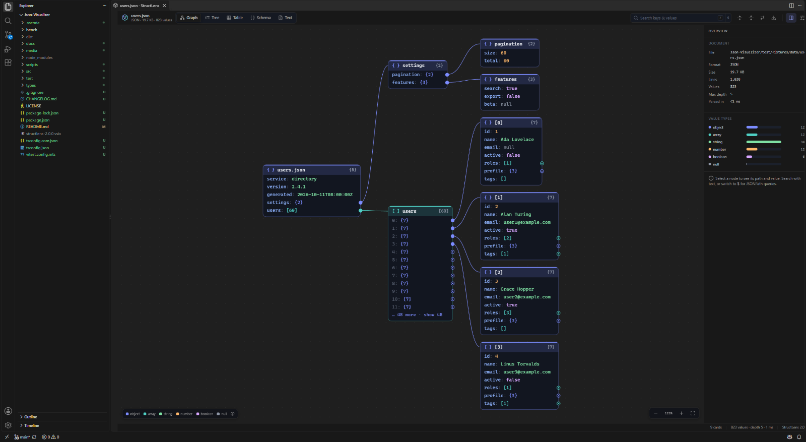
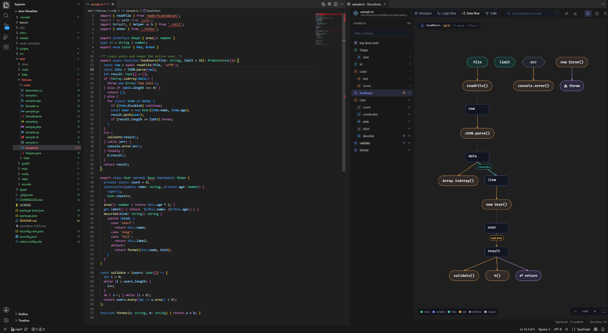
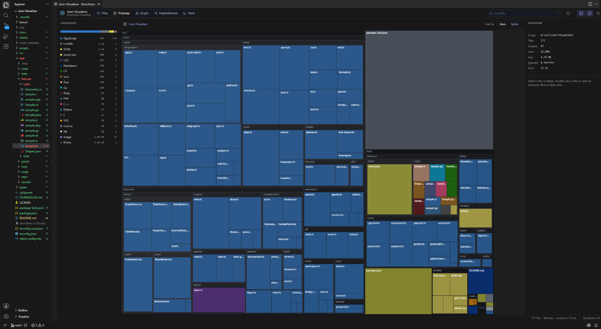
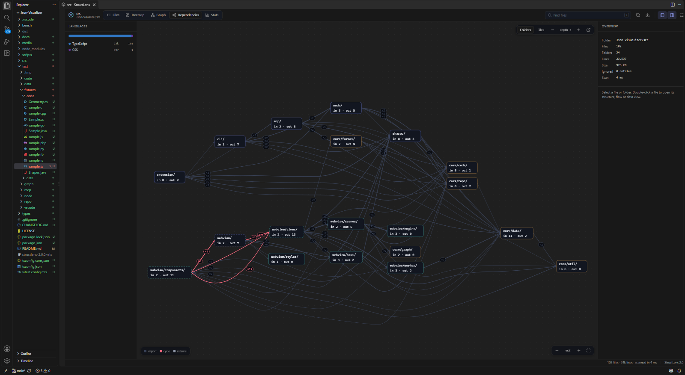
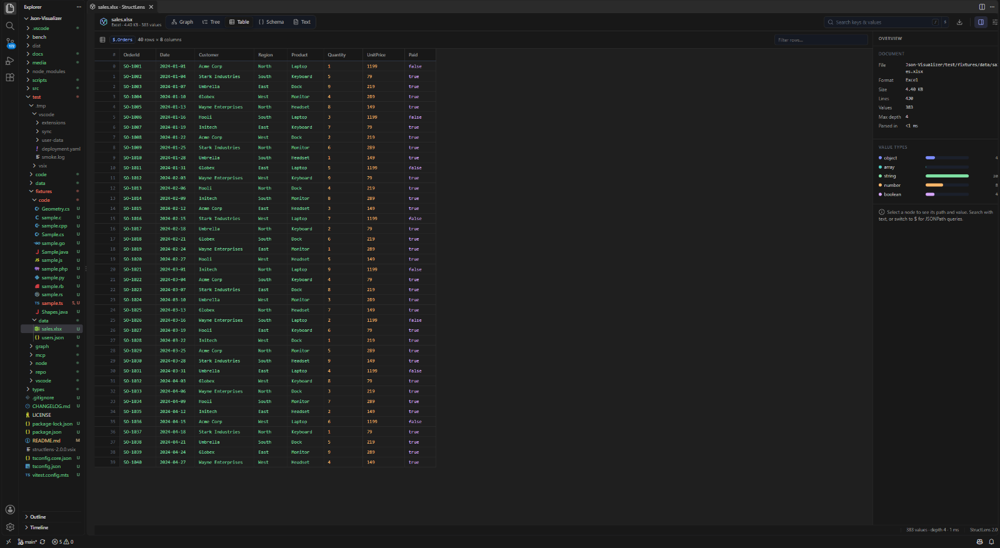
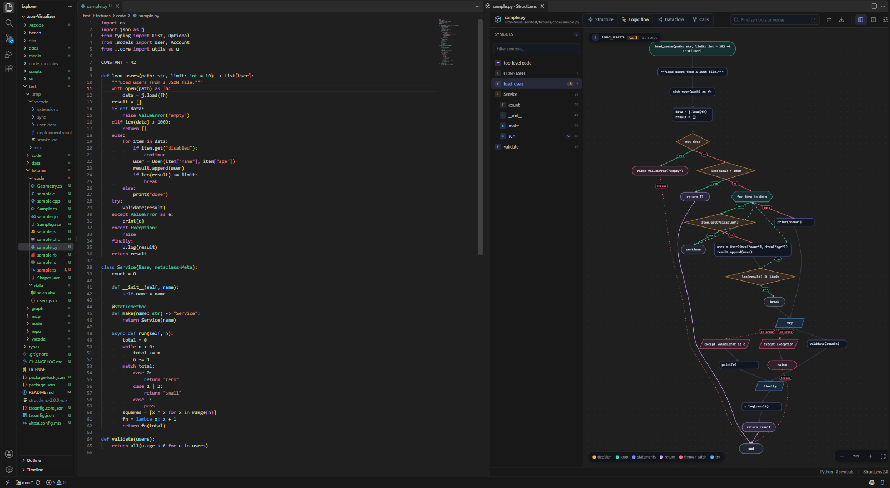
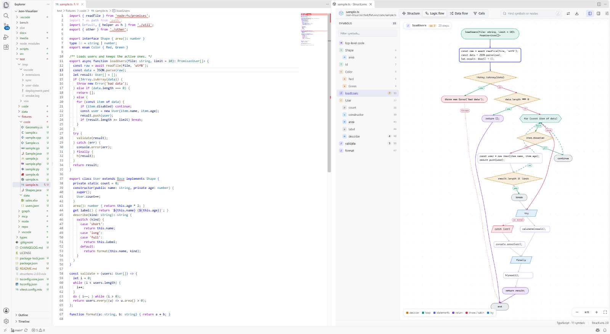

# StructLens

**See the structure of anything in your workspace: data files, code, whole repositories. Your AI agents can see it too.**

StructLens is a VS Code extension (plus a CLI and an MCP server) that turns JSON, YAML, XML, TOML, CSV and Excel files into fast interactive graphs, tables and schemas. It draws logic-flow and data-flow diagrams for the function under your cursor and maps repositories as trees, treemaps and dependency graphs. The same views are available to GitHub Copilot, Claude Code, Codex, Cursor and any other MCP client.



- **Data files.** Graph, tree, table, schema and text views for JSON, JSONC, JSON5, JSON Lines, YAML, XML, HTML, TOML, CSV/TSV, Excel (.xlsx), INI, .env and .properties. Includes JSONPath queries, search, schema inference (exportable as JSON Schema or TypeScript) and click-to-reveal in the editor.
- **Code.** Structure, logic flow (control-flow graph), data flow and call graph for TypeScript, JavaScript, Python, Java, C#, Go, Rust, C, C++, Ruby and PHP, parsed with tree-sitter. Outlines cover about 24 more languages (Kotlin, Swift, Scala, Dart, Lua, Elixir, Haskell, …).
- **Repositories.** File tree with sizes and line counts, a zoomable treemap, folder graph, import/dependency graph with cycle detection, and language statistics. `.gitignore` is respected.
- **AI agents.** 14 read-only tools for Copilot agent mode and an MCP server (stdio or HTTP). An agent can also open an interactive diagram in your VS Code window.
- **Fast.** The JSON parser reads about 300 MB/s (a 100 MB file in about a third of a second) and keeps source positions. Parsing runs in a worker. Rendering is a culled, level-of-detail canvas, and big arrays are paged.

## Screenshots

| | |
| --- | --- |
|  **JSON graph.** Cards expand on click; big arrays are paged. |  **Data flow.** Parameters → variables → calls → return value. |
|  **Repository treemap** by lines or bytes, colored by language. |  **Dependency graph** at folder or file level; cycles in red. |
|  **Excel workbook** as a sortable, filterable table. |  **Opened by an AI agent** over MCP, inside VS Code. |

Light themes are followed automatically:



## Install

StructLens needs VS Code 1.101 or newer.

```bash
git clone https://github.com/GhoshSrinjoy/Json-Visualizer.git
cd Json-Visualizer
npm ci
npm run package                                   # → structlens-2.0.0.vsix
code --install-extension structlens-2.0.0.vsix
```

You can also install the `.vsix` from the Extensions view: **⋯ → Install from VSIX…**.

## Using it in VS Code

| Do this | How |
| --- | --- |
| Visualize the current file | `Ctrl+Alt+V` (`Cmd+Alt+V`), or the StructLens button in the editor title bar |
| Logic flow of the function at the cursor | `Ctrl+Alt+F` (`Cmd+Alt+F`), or right-click → **Show Logic Flow** |
| Data flow / call graph / structure | Right-click in a source file, or the Command Palette (**StructLens: Show Data Flow**, **Show Call Graph**, **Show Code Structure**) |
| A folder or the whole repository | Explorer right-click → **Visualize Folder Structure** / **Show Dependency Graph**, or **StructLens: Visualize Workspace** / **Show Repository Treemap** |
| Very large data files | **Open With… → StructLens Visualizer**. It reads the file directly, with no text editor in between. |
| Connect Claude Code, Codex, Cursor… | **StructLens: Connect AI Agents (MCP)…** |

The visualizer follows the editor. Moving the cursor selects the matching node or switches to that function's flow, and clicking a node highlights its source. Edits and saves refresh the view.

Inside the visualizer: `1`–`5` switch views, `/` or `Ctrl+F` searches (type `$` for JSONPath), `F` fits, `+`/`-`/`0` zoom, `E`/`C` expand or collapse all, `D` flips the layout direction, `B`/`I` toggle the side panels, and `R` refreshes. Every diagram exports to PNG and SVG; code and dependency diagrams also export to Mermaid.

### Data files

- **Graph**: expandable cards, one per object or array, with the type, size and values inline. Arrays of records show a sample first, and big arrays are paged.
- **Tree**: a virtualized outline that stays fast with millions of nodes.
- **Table**: picks the array of records automatically, with sorting and filtering.
- **Schema**: the inferred structure, including optional fields with presence %, enums, formats (date-time, email, uuid, …) and numeric ranges. Copy it as JSON Schema or TypeScript.
- **Text**: the source with syntax errors listed. Parsing is tolerant, so a broken file still shows everything that could be read.

Excel workbooks become one record array per sheet (the first row is the header, and dates are decoded). They then work with the same views, queries and schema inference as JSON.

### Code

- **Structure**: classes, functions, methods and fields with signatures, line ranges and cyclomatic complexity.
- **Logic flow**: decisions with yes/no branches, loops with back edges, `switch`/`match` cases, `try`/`catch`/`finally`, early returns, `throw`, `break`/`continue` and unreachable code.
- **Data flow**: how values move through a function: parameters → locals → calls → return value, plus fields written, collections mutated and loop iteration.
- **Calls**: the call graph of the file or the whole workspace, resolved through imports.

### Repositories

**Files** (sizes, line counts, languages), **Treemap**, **Graph**, **Dependencies** and **Stats**. The dependency graph handles TypeScript path aliases and workspaces, Python packages, Go modules, Java/Kotlin/C# packages, C/C++ includes, Rust `mod`/`use`, PHP PSR-4 and CSS imports. It reports cycles, hubs and external packages.

## Connect AI agents

### GitHub Copilot (VS Code)

The tools are registered automatically for Copilot Chat in **Agent** mode. Pick them in the tools menu, or reference them in a prompt, for example `#repoOverview`, `#fileStructure`, `#codeFlow` or `#dependencyGraph`. You can turn this off with `structlens.ai.copilotTools`.

### Claude Code, Codex, Cursor, Gemini CLI, Windsurf, Claude Desktop

Run **StructLens: Connect AI Agents (MCP)…** and pick a client. It adds the StructLens MCP server to that client's configuration:

| Client | Where it is configured |
| --- | --- |
| Claude Code | `.mcp.json` in the project, or user scope through `claude mcp add` |
| OpenAI Codex (CLI and IDE) | `~/.codex/config.toml` |
| Cursor | `.cursor/mcp.json` |
| Gemini CLI | `.gemini/settings.json` |
| Windsurf | `~/.codeium/windsurf/mcp_config.json` |
| Claude Desktop | `claude_desktop_config.json` |
| Anything else | **Copy MCP server JSON** |

The extension keeps a copy of the server in VS Code's global storage and refreshes it when the extension updates. It runs with your `node` (18+) or with VS Code's own runtime.

Without VS Code, use the CLI from a clone (`npm ci && npm run build`):

```bash
node dist/cli.js setup claude             # or: codex, cursor, gemini, windsurf, claude-desktop, vscode, json
node dist/cli.js setup codex --dry-run    # show what would be written
```

Or add it by hand:

```bash
claude mcp add structlens -- node /path/to/Json-Visualizer/dist/cli.js mcp
```

```toml
# ~/.codex/config.toml
[mcp_servers.structlens]
command = "node"
args = ["/path/to/Json-Visualizer/dist/cli.js", "mcp"]
```

The server uses the client's workspace roots, or `--root <dir>` (repeatable). For clients that connect over HTTP, run `structlens mcp --http 7811`; the endpoint is `http://127.0.0.1:7811/mcp`.

### What agents can do

| Tool | What it returns |
| --- | --- |
| `repo_overview` | File and line counts, languages, largest files, key config and entry files, top of the tree |
| `repo_tree` | Directory tree with file and line counts |
| `file_structure` | The structure of any file: a schema for data, an outline for code |
| `data_schema` | Inferred schema as text, JSON Schema or TypeScript |
| `data_query` | JSONPath results with paths, line numbers and values |
| `data_search` | Keys and values matching text |
| `data_tree` | An outline of the values at a path |
| `code_outline` | Symbols, imports and exports with line ranges |
| `code_flow` | A function's control-flow graph as Mermaid and text, with complexity |
| `code_dataflow` | How values move through a function |
| `call_graph` | Who calls what, across files |
| `dependency_graph` | The import graph with cycles, hubs and external packages |
| `find_symbol` | Where a symbol is defined |
| `open_visualizer` | Opens the interactive diagram for the user, in VS Code or the browser |

Every tool is read-only and limited to the workspace roots. Output is plain text and Mermaid, sized for a model's context.

When an agent such as Claude Code or Codex calls `open_visualizer`, the diagram opens **inside your VS Code window** if the extension is running there. Otherwise it opens in a browser, or with `--no-browser` the agent gets a link to share.

## Command line

The commands return the same output that agents get:

```text
structlens [path]                 Interactive visualizer in the browser
structlens overview <path>        Repository summary
structlens tree <path>            Directory tree with file and line counts
structlens structure <path>       Structure of any data or source file
structlens schema <path>          Inferred schema (--format text | json-schema | typescript)
structlens query <path> <query>   JSONPath query
structlens search <path> <text>   Search keys and values
structlens values <path> <at>     Outline of the values at a path
structlens outline <path>         Symbols, imports and exports
structlens flow <path> <fn>       Control flow of a function (--format mermaid | text)
structlens dataflow <path> <fn>   Data flow of a function
structlens calls <paths>          Call graph
structlens deps <path>            Dependency graph (--level folder | file)
structlens find <query> <path>    Find symbol definitions
structlens mcp                    MCP server (stdio, or --http <port>)
structlens setup <client>         Register the MCP server with an AI client
```

```bash
structlens query data/users.json '$.users[?(@.active && @.age > 30)].email'
structlens schema exports/orders.xlsx --format typescript
structlens flow src/server.ts handleRequest --format mermaid
```

From a clone, run `node dist/cli.js …`, or `npm link` once to get a `structlens` command.

## Settings

| Setting | Default | |
| --- | --- | --- |
| `structlens.graph.direction` | `LR` | Layout direction of data and structure graphs |
| `structlens.graph.initialDepth` | `3` | Levels expanded when a document opens |
| `structlens.graph.maxVisibleNodes` | `1500` | Upper bound for **Expand all** |
| `structlens.graph.childPageSize` | `50` | Rows per card before “show more” |
| `structlens.animations` / `structlens.minimap` | `true` | Layout animations, minimap |
| `structlens.followCursor` | `true` | Sync the selection with the editor cursor |
| `structlens.theme` | `auto` | `auto` follows the VS Code theme |
| `structlens.repo.respectGitignore` | `true` | Honor `.gitignore` files |
| `structlens.repo.exclude` | VCS, dependency and cache folders | Always-excluded patterns |
| `structlens.repo.maxFiles` | `200000` | Scan limit |
| `structlens.repo.countLines` | `true` | Count lines while scanning |
| `structlens.ai.copilotTools` | `true` | Offer the tools to Copilot agent mode |
| `structlens.ai.mcpServer` | `false` | Also publish StructLens through VS Code's MCP support |
| `structlens.ai.bridge` | `true` | Let MCP agents open views in this window |

## Privacy and security

Everything runs locally and nothing is uploaded. The agent bridge and the browser visualizer listen on `127.0.0.1` only and require a random per-session token. Bridge details are stored in `~/.structlens/bridges`, readable only by you. MCP tools are read-only, and paths outside the workspace roots are rejected.

## Development

```bash
npm ci
npm run build          # or: npm run watch
npm test               # unit tests (vitest)
npm run typecheck
npm run test:vscode    # smoke test in a real VS Code with a throw-away profile
npm run screenshots    # the smoke test, saving docs/screenshots/*.png
npm run bench          # parser benchmark on generated 100 MB files
npm run package        # build the .vsix
```

Press `F5` with the repository open to launch an Extension Development Host. The code is laid out as follows:

- `src/core`: platform-independent parsers, analysis and layout.
- `src/node`: the workspace, file system and agent bridge.
- `src/mcp`: tool definitions and the server.
- `src/extension`: the VS Code integration.
- `src/webview`: the UI, shared by VS Code, the CLI server and the static site in `dist/web`.

## License

[MIT](LICENSE) © Srinjoy Ghosh
